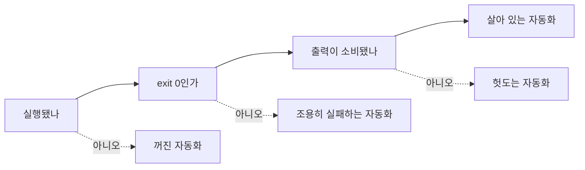

## 들어가며

2026-10-12, 이 위키 저장소와 aidy 4개 저장소의 매일 돌던 자동화를 전부 철거했다. 지금 활성 작업은 면접 준비(`job-prep` 브랜치)라서 위키 봇을 더 운영할 이유가 없었다. 철거 자체는 PR 한 장(워크플로 13개 삭제)이면 끝나는 일이었다.

이 저널은 철거 과정에서 **실행 이력을 실측해 보니 기억과 전혀 달랐던 것들**을 기록한다. 교훈은 세 가지다.

1. **꺼진 자동화보다 조용히 실패하는 자동화가 더 오래 산다.** 스카우트 봇 3개는 6월 말 이후 301번 실행해 301번 모두 실패했는데, 3개월 반 동안 아무도 몰랐다.
2. **기본 브랜치에서 워크플로 파일을 지워도 자동화는 꺼지지 않는다.** 옛 브랜치를 타고 auto-merge가 되살아나 PR을 사람 리뷰 없이 머지했다.
3. **"살아 있지만 틀린" 경로는 에러보다 위험하다.** 훅이 3개월 동안 멈춘 옛 클론을 검사하고 있었다.

## 1. 실측 — 기억 속 상태 vs 실행 이력

철거 직전 NEXT.md에 "실제로는 6월부터 대부분 `disabled_inactivity` 상태였다"라고 적었다. 6월쯤부터 봇 산출물이 안 보였으니 GitHub가 비활성 저장소의 스케줄을 꺼버렸을 거라고 *추정*한 것이다.

철거 후 `gh run list` 로 실행 이력 1,000건을 집계해 보니 이 추정은 틀렸다. 스케줄 실행은 월 140회 안팎으로 **10월까지 한 번도 멈추지 않았다.**

| 워크플로 | 실행 | 실패 | 마지막 성공 |
|---|---|---|---|
| Daily Scout — GeekNews | 160 | 107 | 2026-06-27 |
| Auto Lesson from GeekNews | 160 | 127 | 2026-06-11 |
| Daily Scout — Blake Crosley | 156 | 124 | 2026-06-11 |
| Weekly Learning Report | 24 | **24** | 없음 |
| Solution Promotion Scan | 24 | **24** | 없음 |
| Weekly Search Quality Benchmark | 24 | 7 | 2026-10-12 |
| Weekly Resolver Eval | 24 | 0 | 2026-10-12 |
| Daily Topic Suggestions | 161 | 0 | 2026-10-06 |

*(2026-04-29 – 2026-10-12, 스케줄 트리거만 집계)*

데일리 봇 3개는 6월 말 이후 **매일 실패했다**. 주간 리포트와 승격 스캐너는 **한 번도 성공한 적이 없다.** 이 표에 있는 실패만 413건이다. 데일리 봇 3개만 보면 셋 다 마지막으로 성공한 6/27 다음 날부터 철거일까지 **301번 실행에 301번 실패**했다.

왜 아무도 몰랐을까. 실패 알림 메일은 왔을 것이다. 하지만 매일 오는 실패 메일은 하루 이틀 만에 배경 소음이 된다. **알림의 빈도가 높을수록 알림 하나의 정보량은 0에 수렴한다.** [fixture-silent-failure-trap](/wiki/harness-engineering/fixture-silent-failure-trap)이 다룬 "조용한 실패"가 코드 레벨이었다면, 이건 운영 레벨의 같은 현상이다.

### 초록불도 죽어 있을 수 있다

더 교묘한 건 `Daily Topic Suggestions` 다. 161번 실행에 실패 0건이다. 그런데 이 봇의 역할은 "오늘 쓸 주제 3개를 이슈로 추천"하는 것이고, 그 이슈를 픽해서 엔트리를 만드는 다음 단계가 8월 이후 한 번도 돌지 않았다. 위키 엔트리 증가는 8/03 이후 0이다.

**성공률은 실행 지표이지 효용 지표가 아니다.** 자동화가 살아 있는지 판정하려면 세 가지를 같이 봐야 한다.



이번에 철거한 13개를 이 세 칸에 넣으면 *살아 있는 자동화*는 주간 벤치마크·resolver eval 정도뿐이었다. 그것도 결과를 보는 사람이 없었으니 엄밀히는 헛도는 쪽이다. 철거 판단이 옳았다는 사실도 철거 *후에* 실측하고서야 확인됐다. 순서가 반대였어야 한다.

## 2. 지운 워크플로가 되살아났다

워크플로 13개를 지우는 PR #365는 2026-10-12 06:14 UTC에 머지됐다. 그런데 같은 날 08:23 UTC, 실행 이력에 이게 찍혔다.

```text
2026-10-12T08:23:52Z  🚀 Auto Merge to main  push  success
```

추적해 보니 이렇다.

1. 다른 세션이 삭제 PR **이전에** 분기한 브랜치에서 작업하고 있었다.
2. 그 브랜치에는 `.github/workflows/ai-review.yml`(auto-merge)이 그대로 들어 있었다.
3. 그 브랜치에 push하는 순간, GitHub는 **push된 커밋 안의 워크플로 파일**을 실행했다.
4. auto-merge가 PR #369를 스스로 만들고, 테스트 게이트를 돌리고, **봇 계정으로 squash merge**까지 했다. 사람 리뷰는 없었다.

GitHub Actions의 트리거별 동작이 다르다는 게 핵심이다.

| 트리거 | 어느 브랜치의 워크플로 파일을 쓰나 |
|---|---|
| `schedule` | 기본 브랜치만 |
| `push` | push된 커밋 |
| `pull_request` | PR의 머지 커밋 (head 기준) |
| `issue_comment` | 기본 브랜치 |

그래서 **기본 브랜치에서 파일을 지우면 스케줄만 꺼지고, push 트리거는 옛 브랜치가 하나라도 남아 있는 한 살아 있다.** 이 저장소에서는 실제로 그런 브랜치가 또 있었다. 지금 활성 작업 브랜치인 `job-prep` 에 워크플로 13개가 통째로 남아 있었다. 거기에 push하는 순간 auto-merge가 `job-prep` 을 main에 강제로 머지할 수 있는 상태였다.

조치는 파일 삭제가 아니라 **저장소 단위의 차단 스위치**였다.

```bash
gh api -X PUT repos/<owner>/<repo>/actions/permissions -F enabled=false
gh api repos/<owner>/<repo>/actions/permissions -q .enabled   # → false
```

aidy 4개 저장소까지 5개 모두 `enabled=false` 를 확인했다. 브랜치마다 파일을 지우러 다니는 것보다 이게 확실하다. 나중에 자동화를 다시 쓰고 싶으면 이 설정 하나만 다시 켜면 된다.

> 📌 **일반화:** "기능을 끈다"는 조치는 그 기능의 *모든 진입점*을 막아야 완료된다. 설정 파일 삭제는 진입점 하나만 막는다. 꺼야 할 시스템에 마스터 스위치가 있으면 그걸 쓴다.

## 3. 3개월간 옛 클론을 검사한 훅

철거와 같이 하네스 문서를 최신화하다가 세 번째 문제를 발견했다. 이 저장소의 Claude Code 훅 설정(`.claude/settings.json`)에 클론 경로가 절대 경로로 5군데 박혀 있었다.

```json
"command": "bash /Users/<me>/Develop/ai-study/.claude/hooks/session-start.sh"
```

이 하드코딩은 4월에 들어갔다. 그런데 정본 클론은 그 사이 `~/Personal/ai-study` 로 옮겨졌다. 옛 클론 `~/Develop/ai-study` 는 지우지 않고 남아 있었고, 3개월 동안 갱신이 없었다.

결과는 이랬다.

- 세션 시작 훅은 **옛 클론의** NEXT.md를 읽어서 "1순위 작업"을 안내했다.
- 드리프트 감지 훅은 **옛 클론의** CLAUDE.md 줄 수를 쟀다.
- 빌드 확인 훅은 **옛 클론에서** `npm run build` 를 돌렸다.

전부 exit 0으로 정상 종료했다. 훅 설계 원칙인 "성공은 조용하게, 실패만 드러낸다"가 여기서는 역효과를 냈다. 경로가 아예 없었다면 에러가 나서 첫날 발견했을 것이다. **경로가 살아 있지만 틀렸기 때문에** 아무 신호 없이 3개월이 지났다.

수정은 간단했다.

```json
"command": "bash \"$CLAUDE_PROJECT_DIR\"/.claude/hooks/session-start.sh"
```

훅 스크립트 안쪽도 `${CLAUDE_PROJECT_DIR:-$(git rev-parse --show-toplevel)}` 로 바꿔서 클론 위치와 무관하게 만들었다. 옛 클론은 로컬 전용 브랜치 11개를 `git bundle` 로 백업하고(`git bundle verify` 통과 확인) 휴지통으로 옮겼다. 옛 클론이 사라져야 같은 종류의 실수가 다시 나도 "경로 없음" 에러로 즉시 드러난다.

[plugin-cutover-four-traps-path-reference-integrity](/wiki/harness-engineering/plugin-cutover-four-traps-path-reference-integrity)가 다룬 "경로 참조 무결성"과 같은 계열이다. 차이는 그 글이 *옮긴 직후*의 깨짐을 다뤘다면, 이건 *옮긴 뒤 옛 것을 남겨둬서* 깨짐이 숨은 경우라는 점이다.

## 4. 검증도 틀린 답을 줄 수 있다

마지막으로 배포 확인 단계에서 얻은 교훈이다. 철거와 문서 PR을 머지한 뒤 Vercel 배포를 확인했다. 그런데 확인 도구 쪽에서 두 번 오보가 났다.

**백그라운드 모니터의 성급한 "성공".** 커밋 상태를 폴링하는 모니터가 "배포 성공·반영 확인"이라고 알렸다. 직접 다시 조회해 보니 그 시점에 배포는 아직 진행 중이었다. 원인은 끝내 하나로 확정하지 못했다. 다만 판정 조건이 결과 문자열이 *나타났는지*만 봤고, 그 값이 *최신 커밋의 최종 상태인지*는 따로 확인하지 않았다는 약점은 분명했다.

**출력 가공 프록시.** 토큰을 아끼려고 셸 명령 출력을 요약·필터링하는 CLI 프록시를 쓰고 있었다. 그런데 `curl` 로 같은 페이지를 반복 조회하니 바뀐 응답 대신 같은 결과가 계속 돌아왔다. 프록시를 우회해서 원본 명령을 실행하자 실제 상태가 보였다. 편의용 래퍼가 검증 경로에 끼어 있으면 *검증 대상이 아니라 래퍼를* 검증하게 된다.

**"Canceled"는 실패가 아니다.** 최종 확인에서 내 마지막 커밋의 Vercel 상태는 `failure` 였다. 원인은 "Canceled from the Vercel Dashboard"였다. 바로 뒤에 다른 커밋이 머지되면서 이전 빌드가 대체된 것이다. 후속 커밋이 그 변경을 포함하니 재배포는 필요 없었다. 상태값만 보고 판정하면 오탐이 되고, 사유 문자열까지 읽어야 맞게 판정할 수 있다.

세 경우의 공통 교훈은 하나다. **최종 판정은 가공되지 않은 1차 소스로 한다.** 이번에는 GitHub 커밋 상태 API와 실제 프로덕션 HTML을 직접 받아서 확인했다. 수정한 문구가 페이지에 있는지 세고, 깨진 렌더링 요소(`<del>`)가 0건인지 셌다. 이 확인 과정에서 페이지 하나의 렌더링 버그를 찾았고, 위키 전체를 감사해 보니 같은 버그가 20개 글 23곳에 이미 있었다. 그 내용은 [gfm-single-tilde-strikethrough-trap](/wiki/harness-engineering/gfm-single-tilde-strikethrough-trap)에 따로 정리했다.

## 5. 체크리스트 — 자동화를 끄거나 감사할 때

- [ ] **철거 전에 실측한다.** `gh run list --limit 1000 --json workflowName,conclusion,createdAt` 로 워크플로별 실행 수, 실패 수, 마지막 성공일을 집계한다. 기억으로 상태를 적지 않는다.
- [ ] **세 칸으로 분류한다.** 꺼짐, 조용한 실패, 헛돎(출력 미소비). 성공률만 보지 않는다.
- [ ] **마스터 스위치로 끈다.** 파일 삭제와 별개로 `actions/permissions enabled=false` 를 설정한다. 옛 브랜치에 남은 워크플로 파일을 `gh api repos/<r>/contents/.github/workflows?ref=<branch>` 로 브랜치별로 확인한다.
- [ ] **경로 하드코딩을 grep한다.** 훅·스크립트에서 `/Users/` 같은 절대 경로를 찾아 `$CLAUDE_PROJECT_DIR` 이나 `git rev-parse --show-toplevel` 로 바꾼다.
- [ ] **옛 사본을 남기지 않는다.** 옮긴 뒤의 옛 클론은 bundle로 백업하고 치운다. 남겨두면 잘못된 참조가 에러 없이 성공한다.
- [ ] **배포는 1차 소스로 판정한다.** 커밋 상태의 사유 문자열과 실제 페이지 내용을 확인한다. 래퍼·모니터의 요약은 참고만 한다.

## 맺으며

[harness-journal-001](/wiki/harness-engineering/harness-journal-001-ci-merge-gate)에서 CI 머지 게이트를 만들고, [harness-journal-014](/wiki/harness-engineering/harness-journal-014-hub-auto-merge-inbound-tips)에서 auto-merge를 붙이며 이 저장소의 자동화가 시작됐다. 6개월 뒤 그 자동화를 걷어내면서 배운 건, **자동화를 만드는 것보다 자동화가 아직 일하고 있는지 아는 게 더 어렵다**는 것이다.

[harness-journal-039](/wiki/harness-engineering/harness-journal-039-tmux-worker-pool-to-solo-native-agent-teams)가 "고쳐 쓰는 것보다 메커니즘을 버리는 게 이득"이라는 결론이었다면, 이번 저널은 그 다음 단계를 다룬다. **버릴 때는 진입점을 전부 막았는지까지 확인해야 버린 것이다.**
